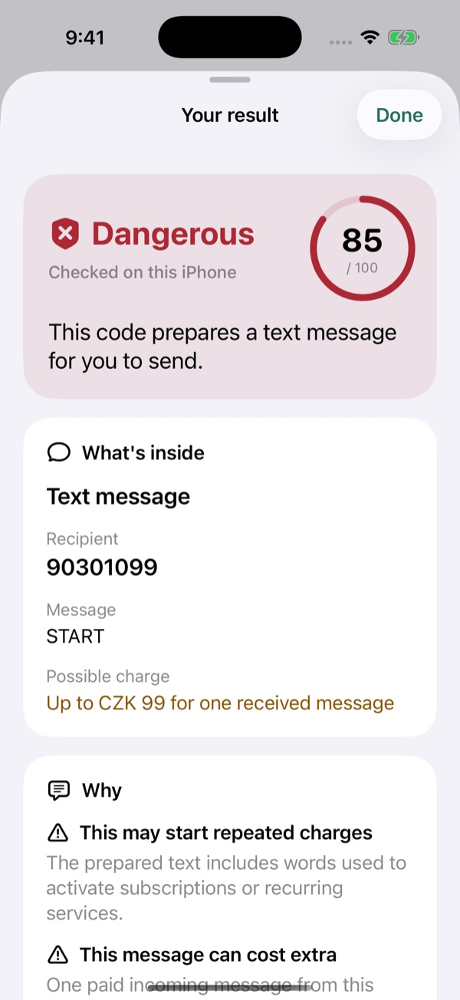
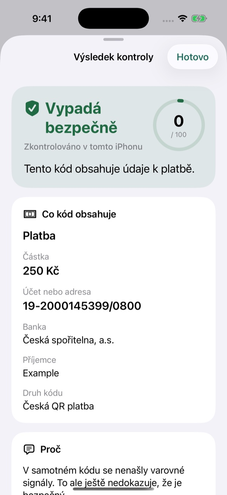
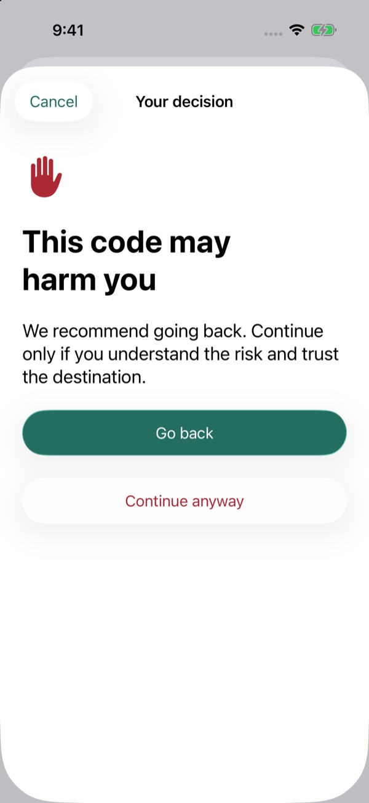
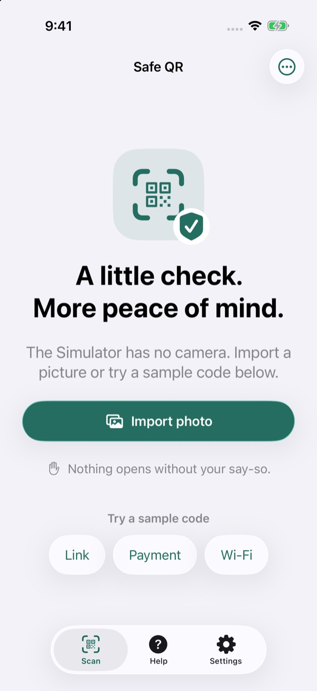
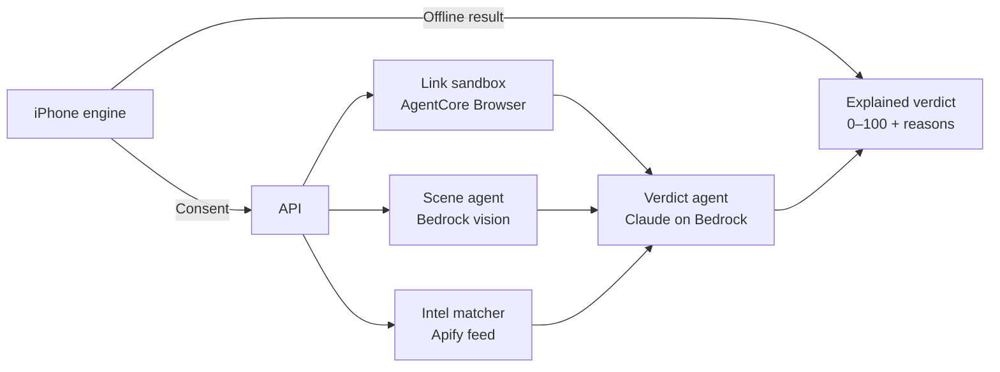

# Safe QR

Know what a QR code does before you act on it.

Safe QR is a native iOS app in Czech and English, plus safeqr.cz: scan a code, read its risk score and reasons, then decide what happens next.

[Website](https://safeqr-web.jakub-f9d.workers.dev) · [QR gallery](https://safeqr-web.jakub-f9d.workers.dev/galerie) · [Training scam flow](https://safeqr-training.jakub-f9d.workers.dev/start)

<table>
  <tr>
    <td></td>
    <td></td>
    <td></td>
    <td></td>
  </tr>
</table>

Simulator screenshots with sample codes. The website uses the Workers address until safeqr.cz is connected.

## Why

- Prague, November 2024: fake EasyPark QR stickers on parking machines led to fake websites. [Praha 10](https://praha10.cz/varovani-pred-falesnymi-qr-kody-na-parkovacich-automatech/)
- Bratislava, April 2026: fake parking-fine notices demanded payment through QR codes. [Municipal police](https://msp.bratislava.sk/novinka/130491/zachranili-sme-zivot-a-postarali-sa-o-stratene-dieta-zasahy-hliadok-303-542026)
- Czech Republic, October 2025: tax-refund phishing emails used QR codes to reach fake login pages. [Finanční správa](https://financnisprava.gov.cz/cs/financni-sprava/media-a-verejnost/tiskove-zpravy-gfr/tiskove-zpravy-2025/dalsi-intenzivni-vlna-podvodnych-emailu-a-sms)
- Microsoft recorded QR-code email-phishing attacks rising from 7.6 million in January to 18.7 million in March 2026: **+146%**. [Microsoft Security](https://www.microsoft.com/en-us/security/blog/2026/04/30/email-threat-landscape-q1-2026-trends-and-insights/)

## How it works



- **On device:** Swift decodes 15 kinds of content, including links, bank payments, crypto, SMS, Wi-Fi and login codes. Offline rules explain the contents immediately; recognized secrets stay on the phone.
- **Link check:** an isolated AgentCore Browser inspects redirects and the landing page. Network guards block private addresses, form submission and downloads.
- **Scene check:** Bedrock vision examines the surrounding photo for signs of an added sticker or a code that does not fit its location.
- **Daily intelligence:** an Apify collector is scheduled for 06:00 Prague time. The matcher compares exact indicators with verified public cases.
- **Risk floor:** AI may raise risk but cannot lower it below the device's proven floor or hide its findings. Model failure returns a deterministic verdict.
- **Your decision:** “Looks safe”, “Be careful” or “Dangerous”, with reasons, consequences and unchecked details. The score is a warning scale, not a probability or guarantee of safety.

## Repository

| Area | Contents |
| --- | --- |
| [ios/](ios/README.md) | SwiftUI iPhone app, Czech and English, iOS 26+ |
| [ios/SafeQRKit/](ios/SafeQRKit/README.md) | Offline engine and `safeqr-inspect` CLI |
| [backend/](backend/README.md) | AWS CDK infrastructure, API, agents and daily intelligence |
| [web/](web/README.md) | safeqr.cz, QR gallery, recovery guides and training flow |
| [spec/](spec/) | [OpenAPI contract](spec/openapi.yaml) and [114 shared conformance fixtures](spec/fixtures/codes.json) |

## Run it

Requirements: [Xcode 27.1](https://developer.apple.com/news/releases/?id=10152026a), iOS 26+; macOS 26 and Swift 6.2+ for the engine CLI. Use pnpm 12.14.0, Node 26 for the backend and Node 22.22+ for the website. See area READMEs for deployment and extended tests.

**iOS and engine — from the repository root.** Select the SafeQR scheme. The test command needs the iOS 26.5 Simulator runtime. Debug builds include sample codes and an optional **Demo deep checks** setting.

```sh
open ios/SafeQR.xcodeproj
xcodebuild -project ios/SafeQR.xcodeproj -scheme SafeQR -destination 'platform=iOS Simulator,name=iPhone 17 Pro,OS=26.5' test
swift run --package-path ios/SafeQRKit safeqr-inspect --locale cs -- 'https://example.com'
swift test --package-path ios/SafeQRKit
```

**Backend — from `backend/`.** Tests and CDK synthesis need no AWS credentials.

```sh
pnpm install --frozen-lockfile
pnpm typecheck
pnpm test
pnpm lint
pnpm synth
```

Deployment requires an AWS SSO profile, Bedrock access and an Apify token. Copy [`.env.example`](backend/.env.example) to `.env`, configure it, authenticate with `aws sso login --profile safeqr`, then follow the [deployment steps](backend/README.md). The live deployment traces the training scam flow and returns a verdict in about 10–15 seconds. Set the deployed endpoint in [the iOS configuration](ios/Configurations/API.xcconfig) and [the website configuration](web/wrangler.jsonc).

**Website — from `web/`.**

```sh
pnpm install --frozen-lockfile
pnpm dev
```

Test and build with `pnpm check`, `pnpm test`, `pnpm build` and `pnpm test:qr`. The App Store release and custom domain are pending.

## Responsible AI and privacy

- Deep-check infrastructure is configured in **eu-central-1**. Bedrock EU inference profiles can route processing across six EU regions.
- Scene photos have metadata removed, use temporary encrypted S3 storage, and are deleted after analysis; a one-day lifecycle rule backs up cleanup. Checks become inaccessible after **24 hours**; physical deletion can lag.
- Recognized secrets are excluded from upload. Wi-Fi, authentication, eSIM, contacts, calendar events, SMS, email and phone codes stay on device. History is off by default.
- Intelligence comes from allowlisted official public sources. Personal-data patterns are stripped before model calls, with a publication gate afterward; filtering is not perfect. Scan data never goes to Apify.
- Verdicts use words and symbols as well as color, and expose evidence, limitations and model IDs: Claude Sonnet 4.5 and Haiku 4.5 on Bedrock. Deterministic rules enforce the risk floor.
- Consented deep checks upload the raw code and device findings; photos need separate consent. Opening links requires confirmation, and dangerous handoffs require a second decision. Copy and share remain explicit user actions.

## Built during the hackathon

Built at **The FinTechers Hackathon 2026**, Prague, **19–20 October 2026**, **Track 7**. The repository started empty: the [`hackathon-start`](https://github.com/jakubsejkora/safeqr/tree/hackathon-start) tag marks the kickoff commit. Everything after it was built during the event.

AI assistance: orchestrated with **Claude Code (Claude Opus 5.5)**, with implementation by **OpenAI Codex agents (GPT-6 Astra)**. Commits disclose AI assistance through co-author trailers.

- Native bilingual app with camera scanning, photo import, explanations and confirmations.
- Offline Swift engine, CLI and shared conformance suite.
- Asynchronous cloud API, link sandbox, scene analysis and verdict agent.
- Daily public-source intelligence collection and exact-indicator matching.
- Bilingual website, 30-example QR gallery, recovery guides and printable demo kit.
- Separate training redirect chain and a card form that sends and stores nothing.

## License

[MIT](LICENSE).
