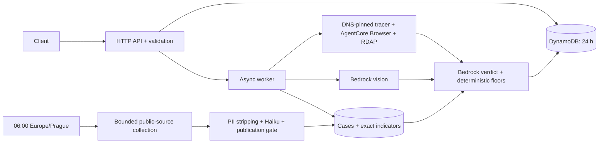

# Safe QR backend

Strict TypeScript, pnpm, CDK v2 and ARM64 Lambda on stable Node.js 24 (Node 26 is still a Lambda preview). Implements `../spec/openapi.yaml`: asynchronous deep checks, localized progress and a public case feed. No AWS credentials are needed to test or synthesize.



From `backend/`, use Node 26 and the pinned pnpm version:

```sh
pnpm install --frozen-lockfile
pnpm typecheck
pnpm test
pnpm lint
pnpm synth
pnpm seed --dry-run
pnpm collect --dry-run
```

For deployment, copy `.env.example` to `.env`, set the SSO profile, and authenticate with `aws sso login --profile safeqr`. Bootstrap once with `pnpm exec cdk bootstrap aws://ACCOUNT_ID/eu-central-1`, then run `pnpm run deploy`. The deploy script runs the checks first; it does not create access keys. Put the Apify token as a **plain string** in Secrets Manager `safeqr/apify-token` in Frankfurt. Set `API_URL`, `CHECKS_TABLE`, `INTEL_TABLE` and `MEDIA_BUCKET` from `deployment.json`. `collect` reads the secret directly into memory; an optional local `APIFY_TOKEN` overrides it. Never print or copy the token. An expired SSO session requires the user to log in again.

```sh
pnpm seed
pnpm collect
pnpm smoke https://safeqr-training.jakub-f9d.workers.dev/start --cs
pnpm smoke https://safeqr-training.jakub-f9d.workers.dev/start --scene test/fixtures/parking-machine.jpg
pnpm smoke 'SMSTO:9030999:START' --kind sms --score 85 --floor 70 --finding sms.premium --finding sms.subscription
```

`seed` imports five bilingual cases curated from the supplied `quishing-intel.md`, without invented indicators. `collect` shares a daily DynamoDB guard with the scheduler. The three pinned actors cap a collection at **$0.76**, plus time/page/concurrency limits. A preflight checks account-wide usage for UTC billing days overlapping the Prague day and leaves a $0.02 margin below $1; this can conservatively skip a day. Actors run with limited permissions. Cheerio requires Apify Proxy. An IAM-authorized invocation with `{ "actor": "apify/cheerio-scraper" }` recovers just that actor, once per day, with the same spend check. Sources are allowlisted institutions and the police website's linked `PolicieCZ` Facebook page. Direct verified article URLs bootstrap discovery alongside targeted Czech, Slovak and German searches. Search snippets are never evidence. Publication dates come from page metadata or explicit publication lines; undated or ambiguous records are withheld. Missing model payload kinds become `unknown`. Only QR-adjacent passages go to extraction, to reduce mixing of unrelated incidents in police digests. Responses return per-source acceptance/rejection reasons; logs retain hashed source IDs and reason codes. Temporary Apify datasets, queues, key-value stores and logs are deleted after use; cleanup failure withholds the affected material. Scan data never goes to Apify.

Resources are in **eu-central-1**; the required Bedrock profiles can route inference within six EU regions. Photos lose their metadata, use private encrypted S3 for the async handoff, and are deleted after analysis, including failures. One-day S3 lifecycle rules provide backup cleanup; physical deletion can lag. Checks become inaccessible after 24 hours and discard their original payload on completion. Screenshots have refreshed 15-minute signed URLs. Check IDs and screenshot URLs are bearer credentials; keep them private.

Every hop is DNS-checked and IP-pinned. A fingerprint-checked public Thawte intermediate completes incomplete server chains; it must be signed by an existing Node root. Partial trust chains, invalid certificates and hostname mismatches remain rejected. Browser traffic uses the same protected fetcher, with request/concurrency/byte limits. Forms, credentials, cookies, downloads and WebSockets are blocked; only one vetted interstitial click is allowed. Limitations appear in the result. Code enforces the device floor, an 80-point known-indicator floor, score levels and matching headlines. Model failure returns a deterministic verdict. Sensitive payload fields are withheld from prompts; source text is filtered before Haiku and gated before publication. PII filtering is conservative, not perfect. Versioned prompts use static cache points; results identify contributing models.

Limits: three model attempts/check, no model retries, 20 attempts/fixed minute (at most 40 across a sliding-minute boundary), 12 checks/minute and 500/day. This account allows 10 concurrent Lambda executions and rejects reservations that leave fewer than 10 unreserved; functions therefore use the shared pool. Powertools emits operation names, token counts and aggregate metrics without scan data. Application errors use RFC 9457; Gateway-generated throttling/oversize errors retain AWS's format. Stranded async checks become failed when polled.

Live API: `https://xj5yhhdhb1.execute-api.eu-central-1.amazonaws.com`. Verified 20 October 2026: real AgentCore sessions, all four training-flow URLs, card detection, private screenshots, photo deletion, both locales and both Bedrock models. Training checks took 10.8–13.8 seconds (including cold starts): 75/100 without a photo, 85/100 with the synthetic parking photo. `example.com` scored 0 in 9.7 seconds; QR Platba and premium SMS completed in 4.3–7.4 seconds. The follow-up fixed Prague's incomplete TLS chain: `www.praha.eu`, `www.csas.cz` and `www.ceskatelevize.cz` scored 5, 5 and 0 in 13.6, 15.5 and 15.5 seconds. The training scam still scored 85 in 9.6 seconds. The first collection's raw records were deleted before detailed diagnostics existed, so its exact per-candidate decisions cannot be recovered. A live replay identified Cheerio's `403 full-permission-actor-not-approved`, then its required proxy input. The five rechecked police posts contained no QR evidence. Null model payload kinds caused four further validation failures; these now map to `unknown` without inferring a payload. Google discovery added four real cases in 108 seconds. The repaired Cheerio run added a fifth case in 38 seconds, with no failed operations. The API now has ten cases in both languages and the website serves the latest five (ten-minute cache). Source review corrected the DHL and SPP summaries. Observed account-wide Apify spend was $0.1723, below $1. All 92 tests, type checking, lint and CDK deployment passed. CORS preflights and RFC 9457 validation errors were verified live.

For `api.safeqr.cz`, pass `-c apiCertificateArn=ARN` to `pnpm run deploy` using a Frankfurt ACM certificate, then point the Cloudflare CNAME to the `ApiDomainTarget` output. The shared spec is unchanged. Proposed corrections: document temporary encrypted photo storage, EU-profile inference, 503 service failures and 400 responses for invalid case queries.

Integration references, checked 19 October 2026: [Lambda runtimes](https://docs.aws.amazon.com/lambda/latest/dg/lambda-nodejs.html), [AgentCore regions](https://docs.aws.amazon.com/bedrock-agentcore/latest/devguide/agentcore-regions.html), [CDP sessions](https://docs.aws.amazon.com/bedrock-agentcore/latest/devguide/browser-managing-sessions.html), [official TypeScript signing implementation](https://github.com/aws/bedrock-agentcore-sdk-typescript/blob/main/src/tools/browser/client.ts), [EU model routing](https://docs.aws.amazon.com/bedrock/latest/userguide/model-card-anthropic-claude-sonnet-4-5.html), [Apify run caps](https://docs.apify.com/api/v2/actors-runs-post). `data/actors.json` snapshots the pinned actors' published input schemas for offline validation.
