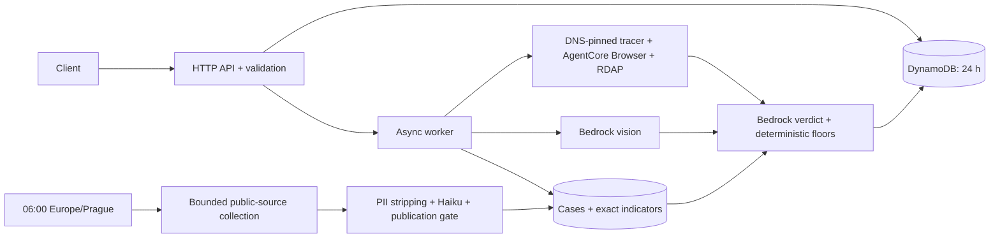

# Safe QR backend

Strict TypeScript, pnpm, CDK v2 and ARM64 Lambda on Node.js 26. Implements `../spec/openapi.yaml`: asynchronous deep checks, localized progress and a public case feed. No AWS credentials are needed to test or synthesize.



From `backend/`, use Node 26 and the pinned pnpm version:

```sh
pnpm install --frozen-lockfile
pnpm typecheck
pnpm test
pnpm lint
pnpm synth
pnpm seed --dry-run
pnpm collect --dry-run
```

For deployment, copy `.env.example` to `.env`, set the SSO profile, and authenticate with `aws sso login --profile safeqr`. Bootstrap the account once with `pnpm exec cdk bootstrap aws://ACCOUNT_ID/eu-central-1`, then run `pnpm run deploy`. The deploy script runs the checks first; it does not create access keys. Put the Apify token as a **plain string** in Secrets Manager `safeqr/apify-token` in Frankfurt. Set `API_URL`, `CHECKS_TABLE`, `INTEL_TABLE` and `MEDIA_BUCKET` from `deployment.json`; set local `APIFY_TOKEN` in `.env`.

```sh
pnpm seed
pnpm collect
pnpm smoke https://safeqr.cz --cs
```

`seed` imports five bilingual cases curated from the supplied `quishing-intel.md`, without invented indicators. `collect` shares a daily DynamoDB guard with the scheduler. The three pinned actors have **$0.76/day** total charge caps, plus time/page/concurrency limits. Sources are allowlisted institutions and the police website's linked `PolicieCZ` Facebook page. Search snippets are never treated as evidence. Undated or ambiguous records are withheld. Temporary Apify datasets, queues, key-value stores and logs are deleted after use; cleanup failure withholds the affected material. Scan data never goes to Apify.

Resources are in **eu-central-1**; the required Bedrock profiles can route inference within six EU regions. Photos lose their metadata, use private encrypted S3 for the async handoff, and are deleted after analysis, including failures. One-day S3 lifecycle rules provide backup cleanup; physical deletion can lag. Checks become inaccessible after 24 hours and discard their original payload on completion. Screenshots have refreshed 15-minute signed URLs. Check IDs and screenshot URLs are bearer credentials; keep them private.

Every hop is DNS-checked and IP-pinned. Browser traffic uses the same protected fetcher, with request/concurrency/byte limits. Forms, credentials, cookies, downloads and WebSockets are blocked; only one vetted interstitial click is allowed. Limitations appear in the result. Code enforces the device floor, an 80-point known-indicator floor, score levels and matching headlines. Model failure returns a deterministic verdict. Sensitive payload fields are withheld from prompts; source text is filtered before Haiku and gated before publication. PII filtering is conservative, not perfect. Versioned prompts use static cache points; results identify contributing models.

Limits: three model attempts/check, no model retries, 20 attempts/fixed minute (at most 40 across a sliding-minute boundary), 12 checks/minute and 500/day. Powertools emits operation names and aggregate metrics without scan data. Application errors use RFC 9457; Gateway-generated throttling/oversize errors retain AWS's format. Stranded async checks become failed when polled.

Deployment and live AWS/Apify behavior remain unverified until credentials work; the roughly 20-second target is not yet measured. For `api.safeqr.cz`, pass `-c apiCertificateArn=ARN` to `pnpm run deploy` using a Frankfurt ACM certificate, then point the Cloudflare CNAME to the `ApiDomainTarget` output. The execute-api URL also works. The shared spec is unchanged. Proposed corrections: document temporary encrypted photo storage, EU-profile inference, 503 service failures and 400 responses for invalid case queries.

Integration references, checked 19 October 2026: [Lambda runtimes](https://docs.aws.amazon.com/lambda/latest/dg/lambda-nodejs.html), [AgentCore regions](https://docs.aws.amazon.com/bedrock-agentcore/latest/devguide/agentcore-regions.html), [CDP sessions](https://docs.aws.amazon.com/bedrock-agentcore/latest/devguide/browser-managing-sessions.html), [official TypeScript signing implementation](https://github.com/aws/bedrock-agentcore-sdk-typescript/blob/main/src/tools/browser/client.ts), [EU model routing](https://docs.aws.amazon.com/bedrock/latest/userguide/model-card-anthropic-claude-sonnet-4-5.html), [Apify run caps](https://docs.apify.com/api/v2/actors-runs-post). `data/actors.json` snapshots the pinned actors' published input schemas for offline validation.
